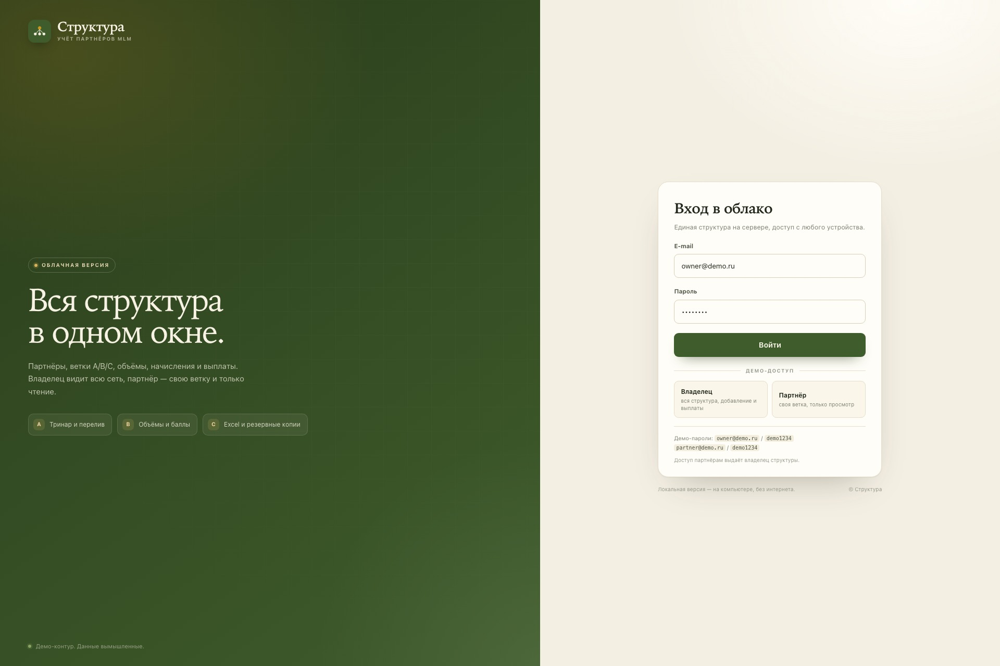
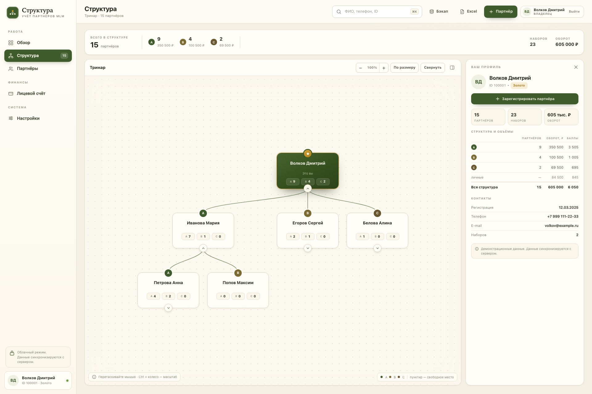
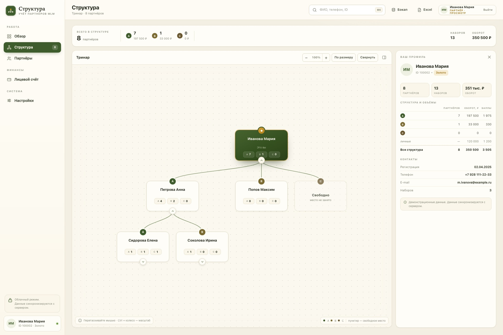

# Структура Cloud

Облачный учёт партнёров MLM: общая структура на сервере, кабинет владельца и
кабинеты партнёров. Готовое приложение с тринаром A/B/C, переливом, объёмами,
оборотами, баллами, лицевым счётом, Excel и бэкапом — в браузере.

Это **вторая версия** приложения. Локальная версия для Windows/macOS/Linux:
<https://github.com/AlexSmol321/struktura-mlm> (офлайн, без паролей и подписок).



## Два кабинета

| Владелец | Партнёр |
|---|---|
| Вся структура, добавление партнёров, переводы, выплаты | Своя ветка, карточки и объёмы, только чтение |
| Меняет данные | Не может менять данные |
| Видит всю сеть | Видит только своих |

Партнёр получает не всю базу, а **свою ветку**: сервер отдаёт только его
поддерево. Все изменения проверяются на сервере, не только скрываются в UI.




## Демо

Демо-контур работает сразу после запуска:

- владелец: `owner@demo.ru` / `demo1234`
- партнёр: `partner@demo.ru` / `demo1234` (ветка Ивановой Марии)

Демо-данные вымышленные. Для реального запуска **смените пароли**, уберите
demo-маршруты и включите HTTPS — см. «Продакшен» ниже.

## Запуск

Нужен Node.js 20+; зависимостей нет.

```bash
node server/server.js
# http://localhost:8082
```

Или через Docker:

```bash
docker compose up -d --build
# http://localhost:8082
```

Данные лежат в `data/db.json` и сохраняются между перезапусками. При первом
запуске база создаётся автоматически с демо-структурой и двумя аккаунтами.

## Аккаунты и роли

Владелец видит всю структуру и может менять данные. Партнёр привязан к
партнёрскому узлу (`partnerId`) и видит только своё поддерево в режиме чтения.

Добавить аккаунт (после первого запуска сервера):

```bash
node server/add-user.js partner2@example.ru 'strong-password' partner 100003
node server/add-user.js owner2@example.ru 'strong-password' owner
```

В Docker:

```bash
docker compose exec struktura node server/add-user.js partner2@example.ru 'strong-password' partner 100003
```

`partnerId` — ID партнёра в структуре. Найти его можно в карточке партнёра в
приложении. Партнёр увидит этого партнёра корнем своей ветки.

## Деплой на VPS (Selectel, Ubuntu)

Нужен домен/поддомен, A-запись которого указывает на публичный IP VPS, и
открытые порты 80/443. Caddy сам получит HTTPS-сертификат.

```bash
# на VPS, из корня репозитория
sudo bash deploy/install.sh cloud.example.ru
```

Скрипт поставит Docker (если его нет), соберёт приложение, поднимет Caddy на
80/443 и проверит `https://<домен>/login`. Данные лежат в `data/db.json` на
хосте; контейнер приложения не публикует 8082 наружу.

Если на VPS уже заняты 80/443 (nginx/Apache/панель), не запускайте Caddy из
этого compose: добавьте reverse proxy на `http://127.0.0.1:8082` в существующем
nginx или освободите порты. В Selectel откройте 80/443 в security group.

Бэкап:

```bash
tar czf /var/backups/struktura-$(date +%F).tgz data
```

Пароли и demo-маршруты — см. «Продакшен» ниже.

## Продакшен

1. Поставьте HTTPS (Caddy, nginx или облачный балансировщик) и
   `COOKIE_SECURE=1`.
2. Смените пароли демо-аккаунтов или создайте новых, удалите `owner@demo.ru` и
   `partner@demo.ru` из `data/db.json`.
3. Уберите demo-маршруты `/demo/owner` и `/demo/partner` из
   `server/server.js` (они входят в сессию без пароля).
4. Сделайте резервную копию `data/db.json`; встроенного планировщика бэкапов нет.
5. Ограничьте доступ к серверу и обновляйте Node.js.

Сессии хранятся в памяти процесса: после перезапуска сервера нужно войти заново.
Для одного небольшого MLM-аккаунта этого достаточно; для нескольких серверов
нужно вынести сессии и базу в Redis/PostgreSQL.

## API

| Метод | Путь | Что делает |
|---|---|---|
| POST | `/api/login` | Вход по e-mail и паролю, сессионная cookie |
| POST | `/api/logout` | Выход |
| GET | `/api/me` | Текущий пользователь |
| GET | `/api/state` | Структура (владельцу — вся, партнёру — поддерево) |
| PUT | `/api/state` | Сохранить структуру; только владелец |

Пароли хранятся как scrypt-хеши. Cookie `HttpOnly`, `SameSite=Lax`; для HTTPS
включается `Secure`.

## Структура проекта

```
server/server.js      HTTP-сервер, вход, роли, API, раздача приложения
server/add-user.js    создание аккаунта владельца/партнёра
public/               ванильный JS-клиент, стили и вход
public/js/app.js      общий интерфейс структуры
public/js/files.js    облачное хранилище вместо локального
public/js/web.js      пользователь, выход, read-only
public/js/tree.js     схема тринара
public/js/model.js    расчёты структуры
data/db.json          данные (не коммитится)
```

## Ограничения

- Начисления и выплаты фиксируются вручную; автоматического расчёта по
  формулам маркетинг-плана нет.
- Нет интеграций с сайтом/CRM и автоматических писем.
- Нет встроенного планировщика резервных копий.
- Один сервер и файловая база; для большого числа пользователей нужна СУБД.

Это демо-приложение для учёта, а не MLM-платформа с автоматическими выплатами.

## Лицензия

MIT. Демо-данные и имена вымышлены.
